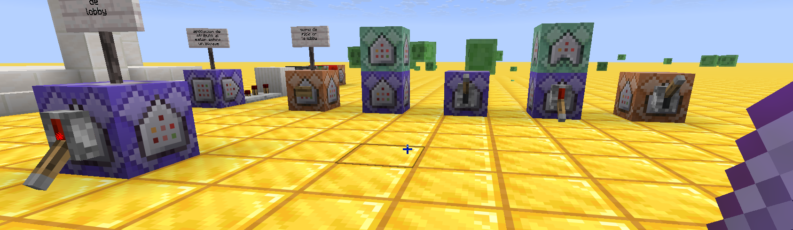
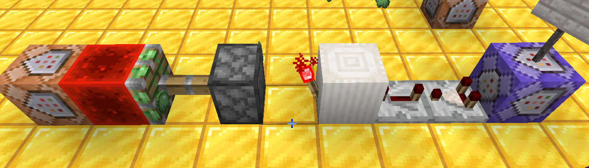

# Lobby experimental

Este montaje se construyó en un mundo de pruebas en solitario. La abeja, el rótulo y el centro de la zona se colocan según la distribución de cada lobby. Las coordenadas siguientes reproducen el ejemplo de las capturas, con el rótulo un bloque por encima de la abeja. Cada módulo tiene su propio circuito.

## Escala al pisar cuarzo

El primer bloque comprueba qué hay bajo los pies de cada jugador y reduce la escala base a 0.5. El segundo restablece la escala predeterminada cuando el circuito de redstone activa el reinicio.

<pre>execute at @a if block ~ ~-1 ~ minecraft:quartz_pillar run attribute @p minecraft:scale base set 0.5</pre>

<pre>attribute @p minecraft:scale base reset</pre>

En el primer comando `@p` se calcula desde cada posición comprobada. En el reinicio se calcula desde el bloque de comandos. Con varios jugadores, la señal del comparador representa el éxito del bloque en conjunto y el reinicio puede elegir a otra persona. Una futura variante individual deberá recordar a quién se aplicó la escala. Un cambio exclusivo del primer selector no resuelve la salida del cuarzo.

## Punto de inicio con una abeja

**Instalación.** Un pulso invoca la abeja. Pulsarlo otra vez crea otra abeja en el mismo punto. Los comandos de efectos le dan resistencia e invisibilidad. Usar una sola abeja para reproducir la prueba. El tag original `input` debe estar reservado al montaje porque los selectores de efectos y partículas alcanzan a todas las entidades con él.

<pre>summon minecraft:bee -5 -22 12 {NoAI:true,Silent:true,Tags:["input"]}</pre>

<pre>effect give @e[tag=input] minecraft:resistance infinite 255 true</pre>

<pre>effect give @e[tag=input] minecraft:invisibility infinite 255 true</pre>

**Partículas.** Bloque de repetición con palanca, configurado como necesita redstone. El autor probó 50 burbujas por ejecución y eligió 40 porque la nube resultaba más cómoda de mirar. También observó lentitud asociada a otras criaturas del mundo.

<pre>execute as @e[tag=input] at @s run particle minecraft:bubble ~ ~ ~ 0.15 0.15 0.15 0.05 40 force</pre>

**Al golpear la abeja: mensaje, sonido y acción.** Coloca los tres bloques en una misma línea, con las flechas en orden. Sustituye el detector de sonido y el antiguo bloque de entrega. Mantén activos los módulos de la abeja y el rótulo. Cada bloque vuelve a identificar al atacante de la abeja marcada en el mismo tick: la cadena transmite la ejecución, pero cada comando necesita establecer su propio destinatario.

1. **Repetición, necesita redstone, incondicional**, con palanca. El mensaje al jugador que golpeó la abeja ya fue probado en el juego.

<pre>execute as @e[type=minecraft:bee,tag=input] if data entity @s {HurtTime:8s} on attacker if entity @s[type=minecraft:player] run tellraw @s {text:"Has activado el punto de inicio."}</pre>

2. **Cadena, siempre activo, incondicional.** Reproduce el sonido en la posición del atacante y se lo envía solo a él.

<pre>execute as @e[type=minecraft:bee,tag=input] if data entity @s {HurtTime:8s} on attacker if entity @s[type=minecraft:player] at @s run playsound minecraft:entity.experience_orb.pickup master @s ~ ~ ~ 1 1</pre>

3. **Cadena, siempre activo, incondicional.** Entrega un diamante al mismo atacante. Para asignar otra acción personal, sustituye únicamente `give @s minecraft:diamond 1` por la acción elegida, conservando el detector y el destinatario `@s`.

<pre>execute as @e[type=minecraft:bee,tag=input] if data entity @s {HurtTime:8s} on attacker if entity @s[type=minecraft:player] run give @s minecraft:diamond 1</pre>

**Probado en el juego.** Al golpear a la abeja una sola vez, el autor vio el mensaje en el chat, oyó el sonido y recibió un diamante. Queda comprobar con un segundo jugador que las tres respuestas llegan solo al atacante.

Para añadir un teletransporte después del diamante, consulta [Acceso desde la abeja a un minijuego](README.md#acceso-desde-la-abeja-a-un-minijuego).

Para un inicio mediante clic derecho, la entidad vanilla `minecraft:interaction` registra por separado el ataque y la interacción y permite identificar al jugador. Es una opción posterior si se prefiere evitar el golpe. [Documentación de Mojang sobre interacciones y atacante](https://www.minecraft.net/en-us/article/minecraft-java-edition-1-19-4)

**Rótulo.** Su propio bloque de impulso coloca el soporte invisible sobre la abeja. El texto orienta al jugador. La detección del golpe pertenece a la abeja.

<pre>summon minecraft:armor_stand -5 -21 12 {NoGravity:true,Marker:true,CustomNameVisible:true,CustomName:[{text:"Click para Iniciar",color:"blue"}],Tags:["titulo"],Invisible:true}</pre>

## Zona de aventura del prototipo

Bloque independiente de repetición, necesita redstone. Al encender la palanca, los jugadores en supervivencia pasan a aventura dentro del radio elegido. Los siete bloques del ejemplo corresponden al tamaño de la zona de pruebas. Esta versión solo define la entrada. El [lobby del servidor](README.md) también define una salida.

<pre>execute positioned -5 -24 12 run gamemode adventure @a[gamemode=survival,distance=..7]</pre>
